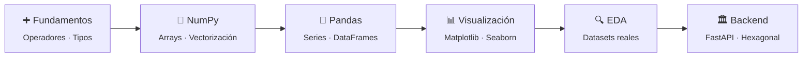
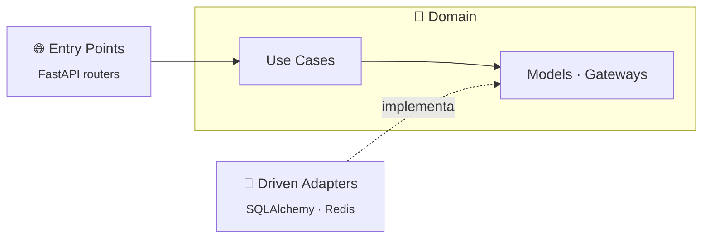

<div align="center">

# 🐍 Python Playground

**Mi espacio para jugar, romper cosas y aprender Python.**

De los operadores básicos y los primeros DataFrames a diseñar un microservicio de producción con arquitectura hexagonal.


</div>

---

## 🧭 ¿Qué es esto?

Este repositorio no es un producto: es una **bitácora de aprendizaje**. Aquí guardo cuadernos de práctica, análisis de datasets reales y el diseño de proyectos más ambiciosos. Algunos son ejercicios de clase; otros, la base de algo que quiero llevar a producción.

La idea es simple: **probar, equivocarse, aprender y dejar registro.**

---

## 🗺️ El camino recorrido



---

## 📂 Estructura

```
python-dev/
├── 📊 analisis-de-datos/     # Notebooks de Jupyter: NumPy, Pandas, gráficos y EDA
└── 🏛️ scaffold-python/       # Specs para un microservicio FastAPI con arquitectura hexagonal
```

---

## 📊 `analisis-de-datos/` — Ciencia de datos con Jupyter

### 📚 Fundamentos

| Notebook | Qué aprendí |
|---|---|
| [`1. Operadores en Python`](analisis-de-datos/1.%20Operadores%20en%20Python.ipynb) | Operadores aritméticos, de asignación, de comparación, lógicos, de pertenencia y de identidad |
| [`2. Numpy`](analisis-de-datos/2.%20Numpy.ipynb) | Arrays y operaciones vectorizadas |
| [`3. Visualización de datos`](analisis-de-datos/3.%20Visualizaci%C3%B3n%20de%20datos.ipynb) | Gráficos de barras, líneas, dispersión e histogramas con Matplotlib y Seaborn |
| [`4. Introducción a Pandas`](analisis-de-datos/4.%20Introducci%C3%B3n%20a%20Pandas%20(vac%C3%ADo).ipynb) | Series, DataFrames y operaciones básicas (plantilla para practicar) |

### 🔍 Análisis de datasets

| Notebook | Dataset | Qué explora |
|---|---|---|
| [🏨 `EDA`](analisis-de-datos/EDA.ipynb) | `reservaciones.csv` | Reservas de hotel: conteo y proporción de reservas canceladas vs. no canceladas |
| [❤️ `heart diseases`](analisis-de-datos/heart%20disease/heart%20diseases.ipynb) | `heart.csv` | Primer vistazo y estadística descriptiva de variables clínicas para predecir enfermedad cardíaca |
| [📺 `youtube channel analisys`](analisis-de-datos/youtube%20channel%20analisys/youtube%20channel%20analisys.ipynb) | `data.csv` | Los canales de YouTube con más suscriptores: idioma, categoría y país |

---

## 🏛️ `scaffold-python/` — Microservicio de producción

Un proyecto **spec-driven**: antes de escribir código, cada decisión de arquitectura y estándar queda documentada en un spec. El objetivo es construir un microservicio de grado producción en Python, **no un ejercicio desechable**.

Está basado en el [Scaffold Clean Architecture de Bancolombia](https://github.com/bancolombia/scaffold-clean-architecture), el mismo que uso en mis proyectos Java, adaptado a FastAPI.

| Capa | Tecnología |
|---|---|
| Framework | FastAPI (async-first) + Pydantic v2 |
| Persistencia | PostgreSQL + SQLAlchemy async + Alembic |
| Caché | Redis |
| Seguridad | Validación de JWT |
| Observabilidad | Logging estructurado + OpenTelemetry |
| Calidad | pytest, tipado estricto, linting, SonarQube |
| Contenedores | Docker + Docker Compose |



### 📜 Los specs

| Spec | Contenido |
|---|---|
| [`AGENTS.md`](scaffold-python/AGENTS.md) | Punto de entrada: intención, stack y cómo se usan los specs |
| [`architecture.md`](scaffold-python/specs/architecture.md) | Capas, patrón Gateway, reglas de importación y equivalencias Java/Spring → Python |
| [`backend-standards.md`](scaffold-python/specs/backend-standards.md) | Tipado, DTOs, manejo de errores, logging, configuración y Dockerfile |
| [`security.md`](scaffold-python/specs/security.md) | Autenticación con JWT y autorización |
| [`testing.md`](scaffold-python/specs/testing.md) | Tests unitarios, mocking, async y cobertura |
| [`business.md`](scaffold-python/specs/business.md) | Dominio del negocio *(por definir)* |

---

## ▶️ Cómo correr los notebooks

```bash
python3 -m venv .venv
source .venv/bin/activate
pip install jupyterlab numpy pandas matplotlib seaborn
jupyter lab
```

---

## 📝 Notas

- Los datasets (`.csv`) son públicos y se versionan junto a su notebook para que cada análisis se pueda reproducir.
- Los entornos virtuales, cachés de Python y checkpoints de Jupyter no se versionan.
- Los secretos se pasan por variables de entorno (`.env`), que tampoco se versionan.

<div align="center">

---

Hecho con 🐍 y mucha curiosidad por **[Andrés Sierra](https://github.com/andysierra)**

</div>
